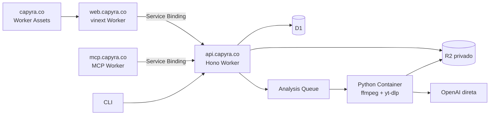

# Arquitetura Cloudflare-first

## Fronteiras

A API e a unica fronteira de negocio. Web e MCP usam Service Bindings; CLI e
clientes externos usam HTTPS. O container nao recebe credenciais de D1 nem de
auth: le e grava objetos no R2 e devolve referencias ao consumer.

D1 contem contas, usuarios, auth/OAuth, assets, analyses, feedback, status,
resumos e referencias. Reports e binarios ficam no R2:

- `staging/`: upload incompleto, expiracao em 24 horas;
- `source-assets/{accountId}/`: fontes privadas concluidas;
- `analyses/{analysisId}/`: report e artefatos deterministicos.

## Analise assincrona

1. `POST /api/v1/analyses` grava `pending` e publica somente `analysisId`.
2. O consumer adquire lease atomico e chama o Container binding.
3. O container valida a midia, executa o pipeline e grava no mesmo binding R2
   por um host HTTP privado interceptado pelo Worker; credenciais R2 nao entram
   no container.
4. O consumer valida o JSON Schema e conclui a linha no D1 atomicamente.
5. Reentregas reutilizam as mesmas chaves; Cron reconcilia pendentes e DLQ.

Fila: lote 1, concorrencia 2, cinco retries, retencao quatro dias e DLQ.
Containers: no maximo dois `basic`, 1 GiB, 4 GB e sleep apos 60 segundos.

## Compatibilidade

Continuam estaveis `/api/v1`, OAuth, payloads camelCase, polling, reports,
artefatos first-party, catalogo, feedback, CLI e MCP. Multipart legado acima de
100 MB retorna `413 direct_upload_required`; upload direto suporta 200 MB.

## Seguranca

Firebase JWKS/Web Crypto, provisionamento automatico sem senha, JWT Capyra,
endpoints locais legados, authorization code com PKCE, refresh rotation e
device flow permanecem. Rate limiting cobre auth,
analises e tickets de upload. CORS e domínios sao restritos, e objetos R2 sao
privados. Logs estruturados contêm IDs, duracao e status, nunca tokens, prompts,
transcricoes ou URLs assinadas.

## Capyra Social

A API permanece a única fronteira de negócio. SocialProvider encapsula o fornecedor; um post externo do fornecedor corresponde a um Destino Capyra. Versões são imutáveis, tentativas são idempotentes e resultados incertos exigem reconciliação. Jobs sociais usam Queue/DLQ separada, com envio de mídia somente dentro de seis dias do agendamento. O Container Python inspeciona metadados sem OpenAI e sem acesso a D1/auth/fornecedor. [Modelo detalhado](../specs/002-capyra-social/data-model.md).
